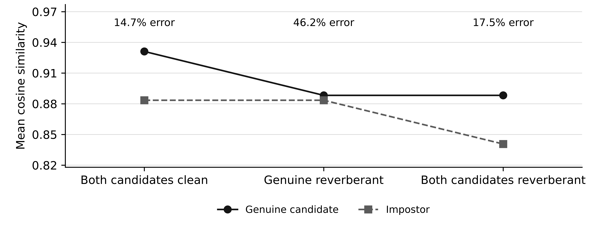
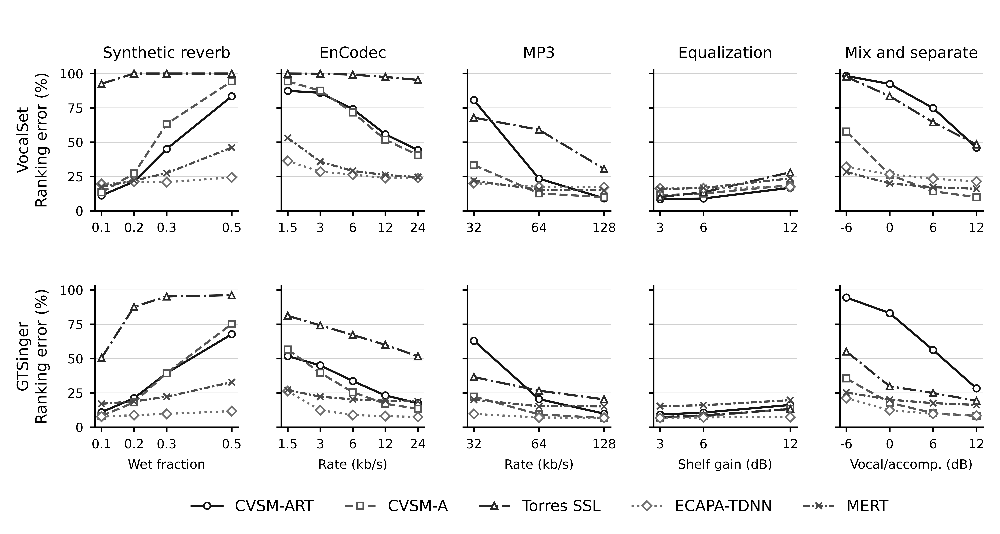

# Singer or Studio? When Production Changes the Match

**A controlled evaluation of singer identity embeddings**

## Abstract

**Introduction.** Singer retrieval compares recordings that may differ in reverberation, coding or vocal isolation. We test whether these changes affect the relative ranking of genuine and impostor recordings.

**Methods.** We evaluate five frozen encoders on VocalSet and GTSinger under 19 controlled production settings. A 100-singer JVS-MuSiC factorial changes the processing of the query, genuine candidate and impostor independently. Follow-up experiments use measured room impulse responses and vocals separated from recorded mixtures.

**Results.** Across the same 17 settings on GTSinger, mean ranking error increased by 17.5 to 44.5 percentage points for three singer encoders, compared with 4.4 for ECAPA-TDNN and 5.2 for MERT. With a dry common-song query in JVS-MuSiC, reverberating only the genuine candidate raised CVSM-ART error from 14.7% to 46.2%. Reverberating the impostor too reduced it to 17.5%. In the measured-response comparison, the primary 20% wet condition fell below the materiality criterion in both cohorts. The larger 50% wet gallery effects were secondary.

**Discussion.** The impostor intervention isolates a contribution of the competing score. Singer retrieval benchmarks should vary processing independently across the three trial roles and report effects by encoder and acoustic condition.

**Keywords** Singing voice, singer retrieval, acoustic mismatch, reverberation, audio coding, source separation

## 1. Introduction

A dry vocal query may be used to retrieve a performance from an archive where voices have been coded, reverberated, or separated from mixtures. A singer embedding may rank an impostor recorded under similar conditions above the genuine candidate. For example, a model may prefer a different singer on another dry recording to the right singer with audible reverberation. An evaluation with uniformly matched recording conditions can miss this error. A usable test must measure genuine and impostor similarities under both matched and mismatched production.

Accompaniment is an established confound in singer identification. Sharma et al. [1] examined how vocal extraction affects singer identification in polyphonic music. Hsieh et al. [2] changed the backing tracks used to train a closed-set classifier and showed that accompaniment affects generalization. Degradation and instrumental leakage also motivate quality-dependent model selection for archival singer identification [3]. Our endpoint is the ordering of a genuine match and an impostor for a fixed query, using frozen representations. The comparison permits a direct intervention on which recording receives a production change.

Several recording-based representations are designed to retain singer or vocal characteristics. Torres et al. [4] compared singing-specific self-supervision with speaker representations. Yakura et al. [5] used pitch and time alterations in their contrastive training scheme to learn singing representations. CVSM learns correspondences between vocals and mixtures, with artist-informed and label-agnostic training schemes [6]. Toma et al. [7] showed that differences in vocal technique between enrollment and verification can be detrimental. Such performance differences arise from the vocal production itself. Here we hold performances fixed and alter the recording or signal processing. General audio embedding sensitivity to effects [8] and the long history of enrollment-to-test acoustic mismatch in speaker recognition [9] make production sensitivity plausible, but leave its size and direction for these singer representations open.

We ask which transformations and strengths change rankings across singer cohorts, how the result changes when the query or either candidate is processed, and which effects remain under measured acoustic responses or on vocals separated from real mixtures. Fixed trials, matched controls, and a song-role swap let us test these questions. Mitigation baselines estimate the trade-off between shifted and clean performance. Throughout, a change in ranking error is specific to the evaluated encoder, trials and processing recipe. The same identity labels are used in every controlled comparison.

## 2. Materials and methods

### 2.1. Corpora and trial units

Table 1 summarizes the evaluation cohorts. VocalSet [10] supplied straight-technique excerpts for the three song identifiers *caro*, *dona* and *row*. The subset has 59 singer-song entries because one of the 60 intended entries is missing. GTSinger [11] supplied 76 natural singing controls for 19 singers, with four distinct recording entries per singer across eight represented languages. In the core cohorts, a four-second window maximizing mean-square amplitude on a half-second grid was selected from the original audio and reused across the corresponding processed versions. For GTSinger, recording slots align trial construction across singers without implying that the singers performed the same song.

For VocalSet and GTSinger, impostors match the query singer's sex label in the corpus-derived manifest and occupy the genuine candidate's song or recording slot. All five encoders retained the same 59 and 76 crops per condition, respectively. VocalSet provided 116 ordered genuine recording pairs and 1,032 eligible triplets per condition. GTSinger provided 228 and 1,944. Those counts apply to clean, genuine-only and both-candidate comparisons. The supplementary crop manifests identify the recordings, slots, offsets and grouping labels.

In JVS-MuSiC [12], each singer sings one common song and a separate singer-specific song. We used the centered four seconds of each raw vocal, matching impostors within the corpus’s six voice-range groups. Both orientations of the two song roles were evaluated. Each orientation has 100 genuine pairs and 1,568 eligible impostor comparisons. A shared song role restricts variation within a gallery, although common and singer-specific songs still differ in content across query roles.

CoVox [13] and NUS-48E [14] were used for the measured-response matching comparison. CoVox contributed the two existing pop renditions with lyrics (AL and CH) per singer, with centered windows and symmetric padding when needed. For NUS-48E we retained the four existing source recordings and their fixed high-energy crop offsets per singer. Each NUS gallery contains one recording per eligible identity at the corresponding within-singer recording slot, without a sex or song-title match across singers. These corpora were used in earlier exploratory work for style or codecs, and their singers were outside the shared-reverberation discovery analyses. The new measured responses were also outside the earlier eight-response set.

**Table 1.** Cohorts and experimental roles. Recording counts are prior to processing. The MUSDB18 unit is the track.

| Corpus | Singers or tracks | Recordings | Purpose |
| --- | --- | --- | --- |
| VocalSet | 20 singers | 59 | Controlled sweep and measured-response follow-up |
| GTSinger | 19 singers | 76 | Fixed-condition replication and measured-response follow-up |
| JVS-MuSiC | 100 singers | 200 | Full factorial and song-role swap |
| CoVox | 22 singers | 44 | Held-out measured responses and mixed galleries |
| NUS-48E | 12 singers | 48 | Held-out measured responses and mixed galleries |
| MUSDB18 | 147 tracks | 147 | Source separation on recorded mixtures |

### 2.2. Acoustic treatment and production conditions

The core sweep used 19 processed variants plus a clean condition. Source signals were converted to mono at 44.1 kHz. The processed signal was cropped at the source window and scaled to a peak amplitude of 0.5. For reverberation we used the dry/wet mixture

**(1)** y(t) = (1 − w)x(t) + w σ(x) / [σ(z) + ε] · z(t), with z(t) = (h ∗ x)(t),

where *x* is the source signal, *h* the impulse response, *w* the wet mixing coefficient, *σ* the signal standard deviation, and *ε* = 10⁻⁹. The convolved signal was truncated to the duration of *x*. Here the source is the dry term and the convolution supplies the wet term. Before weighting, the two components have approximately equal standard deviation by construction. A 20% setting leaves dry and wet coefficients of 0.8 and 0.2. A 50% setting uses 0.5 and 0.5. These are mixing coefficients of two correlated signals. A physical direct-to-reverberant ratio also depends on the response and on where the direct arrival is separated from the reflections.

The synthetic response was generated from seeded Gaussian noise under a one-second exponential decay calibrated to a 60 dB decay, truncated at 1.2 s and normalized in energy. The core sweep reused the fixed response across clips at each wet level. JVS-MuSiC used the 24 kHz source rate, a 0.20 wet fraction and a fixed recording-specific seed per file. Thus “matched” in that synthetic JVS experiment means the same recipe and wet fraction. It can involve independent realizations of the response.

EnCodec [15] used its 24 kHz mono model. MP3 used FFmpeg and libmp3lame. A separate bandwidth control applied a forward-backward eighth-order Butterworth low-pass filter at 11 or 16 kHz to clean VocalSet crops. Equalization used opposite shelves at 200 Hz and 4 kHz. The separation intervention mixed the vocal with MUSDB18 accompaniment at a fixed ratio and extracted it with HTDemucs [16]. A follow-up used five further backing tracks. Table 2 gives the common sweep settings.

For the measured-response comparison we used impulse responses from the MIT survey of Traer and McDermott [17]. The responses were averaged to mono, aligned at the maximum-amplitude sample, and normalized in energy before convolution. The first set of eight responses covered the surveyed range of estimated decay times by quantile selection. We used a Schroeder energy decay curve and fitting range of −5 to −35 dB to estimate broadband T30. The separate matching comparison selected four pairs of distinct indoor response files at target T30 values near 0.30, 0.45, 0.60 and 0.80 s, with a required gap of at most 0.08 s. The resulting gaps ranged from approximately 0.009 to 0.029 s. Within each comparison the render used the same wet fraction (0.20 primary, 0.50 stress test). These coefficients give nominal dry-to-scaled-convolution standard-deviation ratios of about 12 dB and 0 dB before cropping, by Eq. (1). Those ratios describe the weighted render components. The convolution contains the aligned direct arrival and reflections and can correlate with the dry signal. The comparison controls broadband decay approximately and tests exact filter sharing in rendered recordings.

**Table 2.** Variables in the controlled VocalSet and GTSinger sweep.

| Treatment | Settings | Signal operation |
|---|---|---|
| Synthetic reverberation | Wet fraction 0.10, 0.20, 0.30, 0.50 | Exponentially decaying noise response, nominal 60 dB decay in 1 s |
| EnCodec | 1.5, 3, 6, 12, 24 kb/s | 24 kHz neural encode/decode |
| MP3 | 32, 64, 128 kb/s | Mono encode/decode with libmp3lame |
| Equalization | ±3, ±6, ±12 dB | Low shelf at 200 Hz and high shelf of opposite sign at 4 kHz |
| Mix and separate | −6, 0, +6, +12 dB | Vocal-to-accompaniment ratio followed by HTDemucs |

### 2.3. Frozen encoders and scoring

We used the released CVSM-ART (artist-informed, HTDemucs Music4All checkpoint) and CVSM-A (label-agnostic, Open-Unmix Music4All checkpoint) from the CVSM project [6]. Each clip was resampled to 16 kHz, split into four one-second windows, and normalized per window. A 64-band log-Mel representation was passed to the encoder before averaging across windows. The Torres contrastive voice-conversion checkpoint [4], denoted Torres SSL below, used peak-normalized 44.1 kHz waveform input. ECAPA-TDNN [18] used the SpeechBrain VoxCeleb checkpoint on 16 kHz audio. For MERT-v1-95M [19], 24 kHz inputs were normalized and the representation was averaged across 13 hidden-state tensors and over time. All model representations were normalized for cosine scoring. The embedding rule excluded crops containing a completely silent one-second quarter. To verify common trial support, we matched all five saved embedding indexes against the VocalSet and GTSinger manifests and reconstructed the eligible trial lists. There were zero skipped crops and identical trial membership across encoders and conditions in both cohorts.

For a query *q*, a genuine candidate *p* from another recording by the same singer, and an impostor *n*, define the margin as

**(2)** m(q, p, n) = cos(q, p) − cos(q, n).

A ranking error occurs when *m* is less than or equal to zero. We average within each query singer and then give each singer equal weight. Top-rank error asks whether any impostor in the gallery equals or exceeds the genuine score. Pairwise error estimates the proportion of such reversals over eligible impostors. Equal error rate (EER) is a separate metric from thresholding genuine and impostor scores and is available descriptively for the original JVS roles in the supplementary outputs. The study does not estimate a deployment false acceptance or false rejection rate at a fixed threshold.

The core design uses a clean query, a genuine candidate that is clean or processed, and a clean same-group impostor at the candidate song or recording slot. The candidate control processes the genuine and impostor candidates alike and leaves the query clean. Analysis of the full JVS factorial also uses an all-processed control, in which the query and both candidates share the processing recipe. We identify the arrangement explicitly in results.

### 2.4. Statistical contrasts and replay checks

For the core sweep, the primary descriptive contrast is the change from clean ranking error for each transformation and encoder. Percentile intervals use 2,000 paired query-singer bootstrap draws with the gallery fixed. For shared-set and model-specific mean contrasts, query identities are ordered lexicographically before using NumPy's PCG64 generator with seed 0. Both summaries give the same interval whenever they use the same condition set. The supplement records the archived and harmonized intervals. The original screening rule selected a transformation in VocalSet if its point estimate increased by at least 10 percentage points and the lower 95% bound exceeded zero. The resulting per-encoder sets were then evaluated unchanged on GTSinger. The 17-condition union of the CVSM-ART and Torres SSL sets was used for ECAPA and MERT summaries. Consequently, the per-encoder averages describe different lists of conditions. The shared-condition curves support direct comparison at individual settings. The screening intervals are descriptive and unadjusted for the number of conditions. VocalSet discovers the conditions. GTSinger estimates their effects with the selection held fixed. Section 3.2 compares models on one common set. Supplement S2 also reports the original model-specific selections.

In the JVS factorial, each of the query, genuine candidate, and impostor can be clean or processed, yielding eight arrangements per transformation in each song orientation. We report the difference between genuine-only and query-only processing, and isolate the effect of impostor processing by holding the query and genuine fixed. The symmetric impostor match contrast compares a matching with a mismatched impostor condition and averages over both settings of the query and genuine candidate. It cancels a constant main effect of the impostor treatment on the mean score. We also examine genuine and impostor cosine changes individually, as these can move together without a comparable change in rank.

For CoVox and NUS, the same factorial compares two different measured responses in a room pair. Both query response assignments and both genuine response assignments receive equal weight. The primary contrast changes only whether the impostor shares the query response. In the corresponding top-rank analysis, the gallery holds one candidate per singer and balances the impostors across the two responses with complementary assignments. The genuine candidate receives either response with equal weight. We compare the mix with a gallery containing the same recordings with all impostors rendered under the nonmatching response. This comparison of total top-rank error is a secondary, post-hoc analysis.

JVS and the measured-response matching analyses use 5,000 paired bootstrap resamples of singer identities in the query and impostor roles. Intervals for the measured-response analysis treat the four response pairs as fixed. The post-hoc top-rank contrasts use query-singer resampling with the galleries held fixed. Before scoring the CoVox and NUS matching study, we recorded a project decision rule for assessing materiality at the primary setting: for Torres SSL, an increase above 5 percentage points on both cohorts, a lower interval bound above 2 points on both, a positive result in at least three of four response pairs on each cohort, and a mixed-gallery preference for matching impostors in both cohorts. This was an internal decision rule recorded before scoring.

We performed three checks: source regeneration and inference for six VocalSet conditions, fresh inference on selected existing VocalSet and GTSinger crops, and independent reconstruction of the full tables from saved embeddings. The six selected conditions were clean, reverb at 0.30, EnCodec at 6 kb/s, MP3 at 64 kb/s, mix and separation at 0 dB, and equalization at ±12 dB.

### 2.5. Real mixtures and mitigation controls

We began with all 150 MUSDB18 tracks [20]. Within each centered 60 s mixture excerpt, we selected the three highest-RMS nonoverlapping 4 s windows on a 4 s grid using the HTDemucs vocal estimate. The same offsets were applied to the reference stem. Seven crops failed the silent-quarter rule, and three tracks lacked a valid ordered query–genuine pair after filtering. The same 147 tracks remained for each encoder, with 100 from the corpus training split and 47 from the test split. Their source splits, offsets, and valid windows are in Supplement S4.

The query always uses the reference stem. The genuine candidate uses a different window of the same track, with the stem and separated estimate compared at the same offset. Impostors come from other tracks with a different credited-artist label, using the corresponding window index. This artist label is a proxy for impostor selection. We average by track and resample tracks for intervals. The released HTDemucs used MUSDB18-HQ training material and additional audio [16], so including the MUSDB18 training split makes this a separation sensitivity check without an independent separator-training holdout. Track-level overlap with singer-encoder training is unresolved.

Two available mitigation baselines provide a check on the clean-to-processed trade-off. The fine-tuning comparison started from CVSM-A and used separate music training clips. The training arms differed in whether the positive was produced under matched or varied conditions. The crop-consistency adapter used alternate versions of the same training crop as positives and required no singer labels for its training objective. We report its clean and shifted-condition errors on VocalSet evaluation singers and on GTSinger. These experiments reuse the benchmark families. Neither baseline was fitted on JVS-MuSiC, CoVox, or NUS for the room-matching tests.

## 3. Results

### 3.1. Direction of mismatch on JVS-MuSiC

With a common-song query, changing only the genuine candidate to 20% synthetic reverb increased CVSM-ART error from 14.7% to 46.2%. With the query processed and both candidates clean, error was 14.1%. The gap between the two mismatch directions was 32.1 points [25.5, 39.1]. It remained 28.9 points [22.5, 35.8] when the singer-specific song supplied the query. The direction difference remained positive for CVSM-A and Torres SSL after the role swap (Table 3).

When the CVSM-ART query stayed clean and the genuine candidate was reverberant, changing only the impostor from clean to reverberant reduced ranking error from 46.2% to 17.5%. Mean genuine cosine stayed at 0.888. Mean impostor cosine moved from 0.883 to 0.841. Averaging the impostor match contrast across the two query and genuine conditions, the common-song orientation showed increases of 14.5 points for CVSM-ART, 12.6 for CVSM-A and 41.1 for Torres SSL. Corresponding estimates for the reverse song orientation were 15.8, 12.2 and 41.4 points. For common-song queries, the symmetric impostor cosine shift was +0.0313 for CVSM-ART and +0.4653 for Torres SSL. Their median clean margins were 0.0443 and 0.0511, respectively (Supplement S1). Figure 1 gives the clean-query comparison. The 28.7-point reduction comes from scoring the same genuine comparison against differently processed impostor recordings. The cosine values in the figure are averages, so the percentage of reversed rankings has to be counted on the individual trials. Supplement S1 provides all arrangements, the clean margin distribution, and a worked calculation. The exact paired reduction for this example was 28.72 [22.76, 35.17] points.

MP3 at 64 kb/s had smaller and model-dependent effects. With common-song queries and MP3 genuine candidates, the increase over clean was 7.3 points for CVSM-ART, 1.5 for CVSM-A and 9.5 for Torres SSL. The CVSM-A interval included zero. The effect of reversing which recording is processed for this encoder also had intervals spanning zero in both song orientations.

**Table 3.** JVS-MuSiC ranking errors (%) for the synthetic reverberation comparison. “Genuine only” and “query only” specify the processed recording. “Both candidates” keeps the query clean. “All” includes the query. The direction gap is the paired genuine-only minus query-only difference in percentage points.

| Encoder | Query song | Clean | Genuine only | Query only | Both candidates | All | Direction gap (pp) |
| --- | --- | --- | --- | --- | --- | --- | --- |
| CVSM-ART | Common | 14.7 | 46.2 | 14.1 | 17.5 | 11.3 | +32.09 [25.45, 39.10] |
| CVSM-ART | Singer-specific | 12.6 | 42.2 | 13.2 | 13.0 | 10.0 | +28.93 [22.47, 35.78] |
| CVSM-A | Common | 14.9 | 47.9 | 12.6 | 16.7 | 13.7 | +35.28 [29.10, 41.63] |
| CVSM-A | Singer-specific | 14.2 | 37.5 | 13.5 | 12.3 | 11.0 | +23.96 [18.16, 30.42] |
| Torres SSL | Common | 18.5 | 98.9 | 31.7 | 36.3 | 19.9 | +67.14 [62.28, 71.87] |
| Torres SSL | Singer-specific | 18.6 | 99.5 | 28.3 | 37.7 | 18.1 | +71.25 [66.31, 76.06] |

### 3.2. Controlled sweep and transfer to GTSinger

The strongest results on VocalSet cover several families rather than a single setting. The comparison that uses the same 17 settings for every encoder is in Table 4. On GTSinger the paired excesses over ECAPA-TDNN were 26.8 [23.6, 29.9] points for CVSM-ART, 13.1 [10.4, 15.8] for CVSM-A and 40.1 [32.9, 47.7] for Torres SSL. These compare increases over each model's own clean baseline. ECAPA-TDNN and MERT are useful controls because they were trained for speech or general music tasks and still showed relatively small shifts in these trials.

**Table 4.** Common 17-condition comparison. Clean error is a percentage. Shift is the mean increase in error from clean in percentage points with a 95% interval. The same 17 settings are used for every encoder. The VocalSet column describes the cohort that supplied the selection. The GTSinger column evaluates those fixed settings on different recordings and singers.

| Encoder | VocalSet clean (%) | VocalSet shift (pp) | GTSinger clean (%) | GTSinger shift (pp) |
| --- | --- | --- | --- | --- |
| CVSM-ART | 8.1 | +47.8 [43.4, 52.4] | 8.9 | +31.2 [27.7, 34.7] |
| CVSM-A | 10.6 | +32.2 [28.4, 35.5] | 7.0 | +17.5 [15.0, 20.3] |
| Torres SSL | 9.5 | +70.8 [65.8, 75.6] | 7.8 | +44.5 [36.8, 53.0] |
| ECAPA-TDNN | 16.6 | +7.0 [4.9, 8.8] | 6.4 | +4.4 [2.8, 6.5] |
| MERT | 15.1 | +10.8 [8.6, 13.0] | 15.3 | +5.2 [3.6, 7.0] |

Figure 2 shows how error changes by treatment and strength. On VocalSet, Torres SSL error rose by 21.1 points with MP3 at 128 kb/s. Low-pass filtering alone raised error by 7.8 points at 16 kHz and 9.3 at 11 kHz. Those filters reproduced only part of the measured MP3 penalty. They do not identify which remaining aspects of coding account for it.

On the 14 CVSM-ART settings originally selected on VocalSet, clean error averaged 8.1%, genuine-only error 65.2%, and both-candidate error 18.2%. The query was always dry. The two controls are informative together. Changing the impostor relieved a large part of the penalty. The remaining 10.1-point difference between clean and both-candidate errors also shows that applying the same production to the candidates did not fully restore the clean result.

The source-render replay reproduced selected VocalSet errors to within one percentage point. Clean, synthetic reverb, MP3 and equalized crops were bit-identical in that replay. EnCodec and separation waveforms varied between runs, with ranking errors still within one point. Fresh inference on selected existing crops and reconstruction from the full saved embeddings matched their references at recorded precision. A level perturbation and RMS-matching check caused no change at recorded precision for its tested conditions. Supplement S5 distinguishes what each replay establishes.

### 3.3. Reverberation under measured responses and mixed galleries

In the first measured-response experiment, changing the genuine candidate increased mean ranking error by 42.7 points on VocalSet and 27.4 on GTSinger for Torres SSL, averaging all wet levels and responses. Corresponding values were 5.2 and 4.6 for CVSM-ART and 7.7 and 6.7 for CVSM-A. The large synthetic response effect therefore persisted under the tested measured responses primarily for Torres SSL. Its error increased most for the longer-decay responses in both cohorts. This is a descriptive association across a selected set of responses whose properties co-vary.

In the follow-up on CoVox and NUS, assigning the impostor the exact response of the query increased Torres SSL pairwise ranking error by 2.29 points [1.45, 3.27] and 4.44 [2.54, 7.01] at the primary 0.20 wet setting. Both point estimates fall below the 5-point criterion. The CoVox interval also excludes a 5-point increase for these four response pairs. The NUS interval still includes increases above 5 points. CVSM-ART changed by 0.20 and 0.16 points. For Torres SSL, exact response sharing shifted mean impostor cosine by +0.0074 on CoVox and +0.0213 on NUS. The corresponding median clean margins were 0.0471 and 0.1359 (Supplement S3). At the 0.50 stress setting the Torres SSL pairwise penalty increased to 22.40 and 14.39 points. Table 5 includes both settings and both models.

At 0.20 wet, matching impostors won 10.21 percentage points more trials than nonmatching impostors on CoVox and 18.54 points more on NUS for Torres SSL. A post-hoc comparison of the mixed gallery against the same gallery with all impostor responses nonmatching increased total top-rank error by 2.81 and 9.01 points, respectively.

At 0.50 wet, error rose from 54.0% to 75.0% on CoVox (+20.97 points [18.29, 23.73]) and from 39.2% to 61.9% on NUS (+22.65 [20.71, 24.76]). The strong-reverb result applies to these rendered responses and this gallery design. Supplement S3 reports the absolute gallery rates and per-response-pair estimates.

**Table 5.** Changes in ranking error (percentage points, 95% intervals) under exact response matching at two wet settings. The paired column changes only the impostor response in a triplet. The secondary top-rank column compares a balanced mixed gallery with all impostors using the alternate response. Its inference holds the gallery fixed and resamples the query singers.

| Corpus | Encoder | Wet | Paired ranking change (pp) | Secondary top-rank change (pp) |
| --- | --- | --- | --- | --- |
| CoVox | Torres SSL | 20% | +2.29 [1.45, 3.27] | +2.81 [0.78, 4.90] |
| CoVox | Torres SSL | 50% | +22.40 [18.86, 25.90] | +20.97 [18.29, 23.73] |
| CoVox | CVSM-ART | 20% | +0.20 [-0.03, 0.52] | +0.99 [0.40, 1.69] |
| CoVox | CVSM-ART | 50% | +2.91 [1.60, 4.50] | +6.69 [4.91, 8.35] |
| NUS-48E | Torres SSL | 20% | +4.44 [2.54, 7.01] | +9.01 [7.48, 10.62] |
| NUS-48E | Torres SSL | 50% | +14.39 [10.70, 19.54] | +22.65 [20.71, 24.76] |
| NUS-48E | CVSM-ART | 20% | +0.16 [0.01, 0.44] | +0.39 [0.09, 0.74] |
| NUS-48E | CVSM-ART | 50% | +1.55 [0.67, 2.70] | +4.25 [2.93, 5.65] |

### 3.4. Mix and separation under new backing tracks and recorded mixtures

Using five additional backing tracks in the synthetic mix and separation design, CVSM-ART's mean ranking error increased by 55.9 points on VocalSet and 46.5 on GTSinger. The corresponding shifts were 42.9 and 18.3 for Torres SSL and 6.3 and 4.3 for CVSM-A. In the auxiliary MUSDB18 same-track test, CVSM-ART had 1.1% ranking error with reference stems, 18.0% with only the genuine candidate separated, and 4.6% with both candidates separated. Its paired change was +16.8 points [14.2, 19.8] from the unrounded rates. The other four changes ranged from +0.7 to +2.6 points. Supplement S4 gives all absolute rates. The results quantify sensitivity to the selected separation pipeline on recorded mixtures. Same-track matching can benefit from shared performance and recording properties, and the inclusion of both MUSDB18 splits limits generalization to tracks unseen by the separator.

### 3.5. Mitigation and artist-level sensitivity checks

The augmentation and adapter pilots showed partial mitigation with encoder-dependent clean costs. On GTSinger, the CVSM-ART adapter lowered shifted error from 46.1% to 23.0% and raised clean error from 8.9% to 13.2%. A separate full-mix Music4All [21] analysis used artist labels. The locally trained Yakura implementation [5] had high baseline error (47.29%) and an inconclusive codec effect (+0.35 points [−5.25, 6.01]). Supplement S6 gives both pilots and their limits.

## 4. Discussion

### 4.1. A recording match can favor the wrong singer

The JVS direction effect survived swapping the song roles. Processing the impostor changed ranking errors at fixed genuine similarity. Production can therefore influence rankings through the impostor score, even when the genuine comparison is unchanged. This establishes a contribution from the competitor score. It leaves open how much identity information remains recoverable and which features the encoders use.

For measured responses at similar decay times, the primary effects were modest. Under stronger reverberation, composition of the gallery mattered for Torres SSL. A pairwise average summarizes comparisons, while top-rank error depends on the most competitive impostor. Evaluations should report the gallery composition and acoustic strength for both metrics and assign processing independently of singer identity where the design permits.

### 4.2. The acoustic recipe matters

In the first measured-response test, changing the genuine candidate increased error most for Torres SSL. In the follow-up, sharing an exact filter had modest effects at the primary setting and larger effects for Torres SSL in the stress test. These experiments use different interventions. Their results describe the response to the tested convolution filters and the role of the impostor within the tested galleries. CVSM-ART showed the largest shift on recorded mixtures separated with HTDemucs. The checkpoints differ in training targets, separator exposure and inference, so their comparison cannot isolate the source of these differences.

Talker- and disturbance-specific findings in own-voice reconstruction [22] illustrate the limits of treating an objective measure as interchangeable with perception. The current endpoint uses labelled recording identity. Stärz et al. [23] compared simulated and measured-response auralisations with a physical loudspeaker reference, and Ernoult et al. [24] documented reference conditions and variability in a musical acoustics benchmark. In our design, convolution with measured responses provides a controlled comparator. Naturally recorded singing in those rooms remains outside the evaluation.

### 4.3. Scope and limitations

The controlled VocalSet and GTSinger cohorts contain relatively few singers, and the GTSinger transfer fixes conditions chosen in VocalSet for each encoder. There are 100 singers in JVS-MuSiC, but only two recordings per singer and three evaluated singer encoders. Swapping song roles controls one aspect of the trial, while leaving the source material and singers the same. CoVox is a female-only singing cohort and NUS-48E supplies a small, unstratified candidate pool. Bootstrap intervals are conditional on the selected recordings, transforms and room responses as appropriate. Correlated comparisons within a cohort cannot substitute for additional independent performers and recording setups.

Absolute reverberation level, room selection and gallery composition were controlled choices. Matching decay time leaves coloration, reflections and source–receiver geometry free to vary. The post-hoc top-rank result describes this stress case and depends on the number and composition of impostors. Sharing exactly the same response file applies the same filter to different voices. A claim about two recordings made in the same physical room would require comparisons across source and microphone positions. The stimuli here have no measured direct-to-reverberant ratios or octave-band decay estimates. Encoder exposure to evaluation material remains incompletely documented, with known CVSM training-domain overlap in Music4All. Mitigation results are limited to the evaluated cohorts and training recipes.

## 5. Conclusion

Production changes altered singer rankings in the tested representations. The selected effects reproduced on GTSinger and the synthetic reverberation asymmetry survived swapping the JVS-MuSiC song roles. Changing only the impostor condition altered rankings. Exact filter sharing had a modest effect at the primary mixing setting and a larger Torres SSL top-rank penalty in the exploratory strong-reverberation galleries. The real-mixture separation effect was largest for CVSM-ART. Singer-embedding evaluations should report processing parameters, which recordings are processed, and matched controls.

## Data availability statement

Source corpora and measured responses are identified in Refs. [10–14, 17, 20, 21] and are available under the providers' terms. The analyzed scores and counts are provided in the supplement. Rendering and inference require the source recordings, checkpoints and software dependencies.

## Declarations

This analysis uses existing audio corpora. No listeners were recruited and no new human responses were collected. OpenAI Codex (GPT-6.2-Sol) assisted with writing, reconciliation of saved results, deterministic plotting code, and the verification scripts. The authors are responsible for the manuscript and its conclusions.

## Supplementary material

The supplementary archive contains S1–S6, crop manifests, singer-level error counts, pseudonymized JVS trial scores, and result and checkpoint fingerprints. Its scripts recalculate the principal scores and reproduce the core shared-condition confidence intervals.

## References

[1] B. Sharma, R.K. Das, H. Li: On the importance of audio-source separation for singer identification in polyphonic music. *Interspeech* (2019) 2020–2024. https://doi.org/10.21437/Interspeech.2019-1925

[2] T.-H. Hsieh, K.-H. Cheng, Z.-C. Fan, Y.-C. Yang, Y.-H. Yang: Addressing the confounds of accompaniments in singer identification. *IEEE ICASSP* (2020). https://doi.org/10.1109/ICASSP40776.2020.9054069

[3] S. Balakrishnan, U. Thayasivam: Quality-aware adversarial ensemble for singer identification in 1960s Tamil film music. *EACL Student Research Workshop* (2026) 150–159. https://doi.org/10.18653/v1/2026.eacl-srw.10

[4] B. Torres, S. Lattner, G. Richard: Singer identity representation learning using self-supervised techniques. *ISMIR* (2023) 448–456. https://doi.org/10.5281/zenodo.10265323

[5] H. Yakura, K. Watanabe, M. Goto: Self-supervised contrastive learning for singing voices. *IEEE/ACM Trans. Audio Speech Lang. Process.* 30 (2022) 1614–1623. https://doi.org/10.1109/TASLP.2022.3169627

[6] C. Garoufis, A. Zlatintsi, P. Maragos: CVSM: Contrastive vocal similarity modeling. *IEEE Trans. Audio Speech Lang. Process.* 34 (2026) 2724–2737. https://doi.org/10.1109/TASLPRO.2026.3677618

[7] S. Toma, T. Ariga, Y. Higuchi, I. Hayasaka, R. Shigyo, T. Ogawa: Exploring impact of prioritizing intra-singer acoustic variations on singer embedding extractor construction for singer verification. *O-COCOSDA* (2024). https://doi.org/10.1109/O-COCOSDA64382.2024.10800601

[8] V. Deng, C. Wang, G. Richard, B. McFee: Investigating the sensitivity of pre-trained audio embeddings to common effects. *IEEE ICASSP* (2025). https://arxiv.org/abs/2501.15900

[9] M. Ferràs, S. Madikeri, P. Motlicek, S. Dey, H. Bourlard: A large-scale open-source acoustic simulator for speaker recognition. *IEEE Signal Process. Lett.* 23 (2016) 527–531. https://publications.idiap.ch/downloads/papers/2016/Ferras_IEEE-SPL_2016.pdf

[10] J. Wilkins, P. Seetharaman, A. Wahl, B. Pardo: VocalSet: A singing voice dataset. *ISMIR* (2018). Dataset https://doi.org/10.5281/zenodo.1193957

[11] Y. Zhang, C. Pan, W. Guo, R. Li, Z. Zhu, J. Wang, W. Xu, J. Lu, Z. Hong, C. Wang, L. Zhang, J. He, Z. Jiang, Y. Chen, C. Yang, J. Zhou, X. Cheng, Z. Zhao: GTSinger: A global multi-technique singing corpus with realistic music scores for all singing tasks. *Adv. Neural Inf. Process. Syst.* 37 (2024). Dataset https://huggingface.co/datasets/GTSinger/GTSinger

[12] H. Tamaru, S. Takamichi, N. Tanji, H. Saruwatari: JVS-MuSiC: Japanese multispeaker singing-voice corpus. *arXiv* (2020). https://doi.org/10.48550/arXiv.2001.07044

[13] C. Bruder, P. Larrouy-Maestri: CoVox: A dataset of contrasting vocalizations. *Behav. Res. Methods* 57 (2025) 142. https://doi.org/10.3758/s13428-025-02664-9

[14] Z. Duan, H. Fang, B. Li, K.C. Sim, Y. Wang: The NUS sung and spoken lyrics corpus: A quantitative comparison of singing and speech. *APSIPA ASC* (2013). https://apsipa.com/proceedings/2013/papers/364_NUS-corpus-Duan-2927261.pdf

[15] A. Défossez, J. Copet, G. Synnaeve, Y. Adi: High fidelity neural audio compression. *Trans. Mach. Learn. Res.* (2023). https://openreview.net/forum?id=ivCd8z8zR2

[16] S. Rouard, F. Massa, A. Défossez: Hybrid transformers for music source separation. *IEEE ICASSP* (2023). https://arxiv.org/abs/2211.08553 · Released model documentation. https://github.com/facebookresearch/demucs

[17] J. Traer, J.H. McDermott: Statistics of natural reverberation enable perceptual separation of sound and space. *Proc. Natl. Acad. Sci. USA* 113 (2016) E7856–E7865. https://doi.org/10.1073/pnas.1612524113

[18] B. Desplanques, J. Thienpondt, K. Demuynck: ECAPA-TDNN: Emphasized channel attention, propagation and aggregation in TDNN based speaker verification. *Interspeech* (2020) 3830–3834. https://doi.org/10.21437/Interspeech.2020-2650

[19] Y. Li, R. Yuan, G. Zhang, Y. Ma, X. Chen, H. Yin, C. Xiao, C. Lin, A. Ragni, E. Benetos, N. Gyenge, R. Dannenberg, R. Liu, W. Chen, G. Xia, Y. Shi, W. Huang, Z. Wang, Y. Guo, J. Fu: MERT: Acoustic music understanding model with large-scale self-supervised training. *ICLR* (2024). https://arxiv.org/abs/2306.00107

[20] Z. Rafii, A. Liutkus, F.-R. Stöter, S.I. Mimilakis, R. Bittner: The MUSDB18 corpus for music separation. Dataset (2017). https://doi.org/10.5281/zenodo.1117372

[21] I.A.P. Santana, F. Pinhelli, J. Donini, L.G. Catharin, R.B. Mangolin, Y.M.G. da Costa, V.D. Feltrim, M.A. Domingues: Music4All: A new music database and its applications. *IWSSIP* (2020). https://doi.org/10.1109/IWSSIP48289.2020.9145170

[22] M. Ohlenbusch, C. Rollwage, S. Doclo, J. Rennies: Subjective quality evaluation of personalized own voice reconstruction systems. *Acta Acust.* 10 (2026) 26. https://doi.org/10.1051/aacus/2026021

[23] F. Stärz, S. Van De Par, S. Roßkopf, L.O.H. Kroczek, A. Mühlberger, M. Blau: Comparison of binaural auralisations to a real loudspeaker in an audiovisual virtual classroom scenario: effect of room acoustic simulation, HRTF dataset, and head-mounted display on room acoustic perception. *Acta Acust.* 9 (2025) 31. https://doi.org/10.1051/aacus/2025012

[24] A. Ernoult, R. Viala, J. Cabaret, J. Chabassier, T. Colinot, J.-P. Dalmont, J.-B. Doc, V. Fréour: Benchmark study of pipe input impedance simulations and measurements for verification and validation in musical acoustics context. *Acta Acust.* 10 (2026) 51. https://doi.org/10.1051/aacus/2026048

## Figure captions

**Figure 1.** JVS-MuSiC CVSM-ART with common-song queries. The middle and right comparisons use the same dry query and reverberant genuine candidate. Only the impostor condition changes. The linked markers show singer-macro mean cosine scores. Error labels use the individual trial comparisons.

**Figure 2.** Singer-macro ranking error across all 19 processed conditions on VocalSet and GTSinger. The genuine candidate is the only processed recording. Supplement S2 gives exact conditions, candidate controls and uncertainty.

## Figures

**Figure 1**

**Figure 2**

